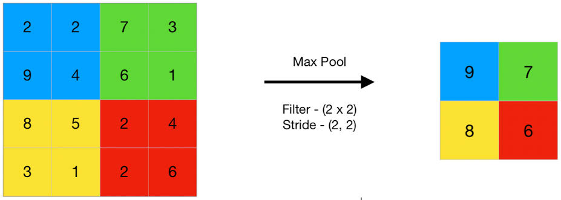
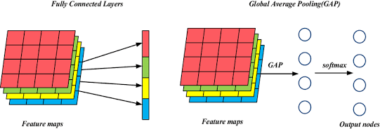

## 목차
✅ CH8-1 CNN은 어떻게 인간의 사고방식을 흉내냈을까, MLP와의 비교 분석  
✅ CH8-2 CNN은 어떻게 특징을 추출할까  
✅ CH8-3 3D 입력에 대한 Convolution  
✅ CH8-4 Padding & Stride & Pooling  
✅ CH8-5 CNN의 Feature map분석  
✅ CH8-6 VGGnet 모델 읽기  
✅ CH8-7 VGGnet 실험  
✅ CH8-8 Beautiful insights for CNN  


## 📚26.10.05 오늘의 TIL  

선행 지식  
 - 인간의 사고방식을 흉내낸 CNN  
  · 기존의 다층 퍼셉트론(MLP, Multi-Layer Perceptron)이 이미지를 단순한 1차원 숫자 배열로 펼쳐서 처리했던 한계를 극복하고, 인간이 시각 데이터를 인식하는 방식과 매우 유사하게 동작  
  · CNN은 이러한 생물학적 메커니즘을 "연결 다발을 끊고(Local Connections), 가중치를 공유하며(Weight Sharing), 위치 구조를 유지하는(Spatial Invariance) 컨볼루션 연산"으로 완벽하게 구현해낸 모델  
 <p align="center"> 
 
 </p>  


### 1. CNN은 어떻게 인간의 사고방식을 흉내냈을까, MLP와의 비교 분석  

 #### 뇌의 신경 다발(Connections)을 끊어낸 구조: 생물학적 모티브  
 - 1959년 비올로지스트 데이비드 허블(David Hubel)과 토르스텐 위젤(Torsten Wiesel)은 고양이의 시각 피질 실험을 통해 인류의 시각 인식에 대한 거대한 발견을 함.  
  · 수용장(Receptive Field)의 발견: 눈에 보이는 전체 화면을 시각 피질 전체가 한 번에 처리하는 것이 아니라, 뇌의 특정 신경 세포(뉴런)는 visual field의 매우 좁은 일부분(국소 영역)에만 반응한다는 사실을 밝혀냄.  
  · CNN으로의 이식: 기존 MLP는 모든 입력 뉴런과 출력 뉴런을 전부 연결(Fully Connected)했지만, CNN은 시각 피질의 수용장 원리를 따라 필터 크기만큼의 좁은 영역(국소 연결, Local Connectivity)만 뉴런이 바라보도록 연결 다발을 잘라냄  

 #### 위치별 특징 추출: 공간 정보(Spatial Structure) 유지  
 - MLP는 $28 \times 28$ 크기의 2차원 이미지를 입력받으면 $784$개의 1차원 벡터로 일렬로 길게 펴서(Flatten) 입력함.    
  · MLP의 문제: 픽셀을 1차원으로 펴는 순간 위-아래, 좌-우 픽셀 간의 공간적 인접성(Spatial Structure) 정보가 모두 파괴됨.    
  · CNN의 해결책: CNN은 $28 \times 28 \times 3$의 3차원 형상을 그대로 유지한 채 필터를 슬라이딩시킵니다. 따라서 "A 픽셀의 바로 옆에 B 픽셀이 있다"는 위치 정보와 픽셀 간 격자 관계를 끝까지 유지한 상태로 패턴을 탐색  

 #### Fully Connected Layer(MLP)에 이미지를 넣을 때와 CNN의 차이  
 - 이미지를 Fully Connected Layer(MLP)에 넣었을 때와 CNN으로 처리할 때의 차이는 크게 3가지    

| 구분 | Fully Connected Layer (MLP) | Convolutional Neural Network (CNN)  
|--- | --- | --- |   
| 입력 형태 | 1차원 벡터 (공간 정보 손실) | 2D/3D 격자 구조 (공간 정보 유지)  
| 파라미터 수 | 폭발적으로 증가 ($H \times W \times C \times \text{뉴런 수}$) | 매우 적음 (필터 크기 $\times$ 필터 개수)   
| 위치 변화 | 위치가 조금만 바뀌어도 완전히 다른 이미지로 인식 | 위치가 이동해도 동일한 특징으로 인식 (위치 불변성)  


 #### CNN에 가이드(사전 정보: 위치, 배열)를 줘야 하는 이유  
 - CNN을 설계할 때 인간은 모델에게 몇 가지 구조적 가정(Inductive Bias, 귀납적 편향)이라는 가이드를 미리 부여해야 함.    
  · 왜 가이드가 필요한가?: 인공지능에게 아무런 제약 없이 "모든 데이터의 관계를 스스로 학습해라"라고 하면(MLP 방식), 엄청난 양의 데이터와 연산량이 필요함.  
  · CNN에 주어지는 사전 정보:  
   1. 국소성 (Locality): "이미지의 특징은 서로 가까운 픽셀끼리 모여서 형성된다."  
   2. 평행이동 불변성 (Translation Invariance): "강아지 코 모양이라는 특징은 이미지 좌상단에 있든 우하단에 있든 동일한 강아지 코다."  
  · 이러한 가이드를 필터의 이동 방식(Convolution)이라는 구조 자체로 주입했기 때문에, CNN은 적은 데이터로도 시각적 패턴을 효율적으로 학습할 수 있음.  

 #### 컨볼루션(Convolution, 합성곱) 연산: 위치별 특징 탐색기  
 - 컨볼루션 연산은 수학적으로 필터(Filter)를 이미지 위에서 한 칸씩 슬라이딩시키며, 국소 영역의 픽셀값과 필터 가중치를 곱하고 모두 더하는 연산(원소별 곱의 합)임.     
  · 작동 원리: 필터의 패턴(예: 대각선)과 이미지 해당 영역의 패턴이 유사할수록 연산 결과값이 크게 나오며, 유사하지 않으면 0에 가까운 값이 나옴.    
  · 결과: 이 연산 결과를 모아 만든 '특징 맵(Feature Map)'은 "이미지의 어느 위치에 대각선/테두리/원형 패턴이 존재하는가?"를 보여주는 위치별 특징 지도가 됨.  

 #### 실제 CNN 연산에서 Connection을 끊는다는 의미와 효과  
 - 연산 수준에서의 의미 (Local Connectivity & Weight Sharing)     
  · 국소 연결 (Local Connectivity): 하나의 출력 뉴런이 입력 이미지 전체와 연결되지 않고, $3 \times 3$ 또는 $5 \times 5$ 같은 필터 영역(수용장) 내의 뉴런들과만 연결(Connection)을 형성. (나머지 영역과의 connection은 0으로 끊어짐)    
  · 가중치 공유 (Weight Sharing): 필터 하나를 이미지 전체 영역에 동일하게 순회시키며 재사용함. 즉, 이미지 위치마다 별도의 가중치 신경망을 만들지 않고 하나의 필터 가중치(Connection)를 공유     

 - 얻는 효과  
  · 파라미터(학습할 가중치)의 획기적 감소: $1000 \times 1000$ 이미지를 100개의 뉴런에 연결할 때, MLP는 $1억$ 개의 가중치가 필요하지만, CNN은 $3 \times 3$ 필터 100개 사용 시 단 $900$개의 가중치만 필요    
  · 과적합(Overfitting) 방지: 모델이 가벼워지므로 메모리가 획기적으로 절약되고 학습 속도가 향상되며, 훈련 데이터에 과도하게 맞물리는 현상이 줄어듬.  
  · 공간 불변성 확보: 이미지가 약간 움직이거나 변형되어도 필터가 슬라이딩하면서 동일하게 특징을 찾아낼 수 있음.  


### 2. CNN은 어떻게 특징을 추출할까  

 #### 필터의 스캔 과정과 특징 추출 (어디에, 얼마나 있는지)  
 - CNN의 핵심은 필터(Filter 또는 Kernel)가 입력 이미지 위를 일정한 간격(Stride)으로 이동하며 쭉 스캔(Scan)하는 합성곱 연산(Convolution Operation)에 있음.   
  · 동작 원리: 필터는 일종의 작은 행렬(ex: $3 \times 3$, $5 \times 5$)이며, 필터가 이미지의 특정 영역(입력 이미지의 부분 영역) 위에 올려지면, 필터의 값과 이미지의 해당 영역 스칼라 값(pixel 값)을 각각 곱한 뒤 모두 더함(점곱, Dot Product).  
  
  · 특징의 위치와 유사도 측정:  
  1. 필터 내부의 숫자 패턴과 이미지 해당 영역의 패턴이 유사할수록 곱셈과 합산의 결과인 출력값이 매우 크게 나타남.  
  2. 반대로 패턴이 전혀 다르면 결과값은 $0$에 가깝거나 음수가 됨.  
  3. 따라서 출력된 행렬의 값은 "해당 특징이 이미지의 어디(위치 정보)에, 얼마나 강하게(값의 크기) 존재하는지"를 나타내는 지도(Map) 역할을 함.  
   <p align="center"> 
 
 </p>  

 #### 컨볼루션: 특징 추출과 이미지 변형(필터링)  
 - 합성곱 연산은 컴퓨터 비전 고전 기술에서의 '이미지 필터링(Image Filtering)'과 원리가 완전히 동일함.     
  · 이미지 변형 (Transformation): 필터의 숫자를 어떻게 구성하느냐에 따라 이미지에 다양한 효과나 변형을 가할 수 있음. 예를 들어, 이미지의 경계선을 선명하게(Sharpening) 만들거나, 흐리게(Blurring) 만들거나, 윤곽선만 남기도록 변형시킬 수 있음.  
  · 특징 추출 (Feature Extraction): 이미지 변형 과정 자체가 바로 중요한 정보(예: 윤곽선, 질감)만 남기고 불필요한 배경 정보는 제거하는 '특징 추출' 과정. CNN은 사람이 직접 필터를 설계하는 대신, 신경망 스스로 이러한 특징을 잘 추출하는 필터를 만들어냄.  

 #### 다양한 필터(가로, 세로 등)와 위치 정보 유지  
 - 이미지 안에는 가로선, 세로선, 대각선, 곡선 등 수많은 종류의 기초 요소들이 섞여 있음.  

  · 다양한 필터의 필요성:  
  1. 가로 필터 (Horizontal Edge Filter): 이미지 내에서 가로 방향의 명암 변화(가로 테두리)만을 강하게 감지함.  
  2. 세로 필터 (Vertical Edge Filter): 이미지 내에서 세로 방향의 명암 변화(세로 테두리)만을 강하게 감지함.  

  · 위치 정보의 유지 (Spatial Structure Preservation): 합성곱 연산은 입력 이미지의 공간적 격자 구조를 그대로 유지하면서 슬라이딩함. 따라서 연산 결과로 나온 지도에서도 "원본 이미지의 왼쪽 위에 있던 세로선 특징은 결과 지도의 왼쪽 위에 그대로 위치"하게 되며, 이는 이미지의 공간적 형태 정보(Spatial Information)를 손실 없이 보존한다는 점에서 매우 중요한 특성.  

 #### 채널 축적과 피처 맵 (Feature Map)  
  · 피처 맵 (Feature Map): 하나의 필터가 이미지를 스캔하여 얻은 2차원 출력 결과물을 피처 맵(Feature Map) 또는 활성화 맵(Activation Map)이라고 부름.  

  · 채널(Channel) 단위 쌓기:  
   1. 한 레이어에서 $N$개의 서로 다른 필터(가로, 세로, 대각선 등)를 사용하면, $N$개의 서로 다른 피처 맵이 생성됨.   
   2. 이 $N$개의 2차원 피처 맵들을 채널(Depth/Channel) 방향으로 차곡차곡 쌓아(Stack) 하나의 3차원 텐서(Tensor, [높이 x 너비 x 채널]) 형태로 만듬.  
   3. 다음 Conv 레이어는 이렇게 쌓인 3차원 피처 맵 전체를 입력으로 받아 더욱 복잡한 합성 특징(예: 가로선+세로선 = 모서리)을 추출하게 됨.  

 #### 학습 파라미터: 커널의 가중치(Weight)와 편향(Bias)  
 - 전통적인 영상 처리에서는 사람이 가로/세로 필터의 수치를 직접 계산해서 작성했지만, CNN에서는 이 값들이 모두 학습해야 할 파라미터(Trainable Parameters)임.  

  · 가중치(Weight): 커널(필터) 내부의 각 셀에 들어있는 숫자들이 곧 가중치($W$)임. 예를 들어 $3 \times 3$ 크기의 필터라면 9개의 가중치가 존재함. (입력 채널이 $C$개라면 $3 \times 3 \times C$개의 가중치)  

  · 편향 (Bias): 필터 연산이 끝난 후 전체 결과에 더해주는 하나의 상수 값($b$). 특정 특징이 얼마나 쉽게 활성화(감지)될지 임계값을 조정하는 역할을 함.    

  · 자세한 학습 과정:  
  1. 초기에는 커널의 가중치와 편향이 무작위(Random) 숫자로 설정  
  2. 필터가 추출한 피처 맵을 바탕으로 최종 예측값(예: "이 동물은 고양이다")을 계산  
  3. 정답과의 오차(Loss)를 계산한 뒤, 역전파(Backpropagation) 알고리즘을 통해 오차를 뒤로 전달  
  4. 경사하강법(Gradient Descent)을 사용하여 "고양이/강아지 특징을 더 잘 찾아내는 필터"가 되도록 커널 속 가중치($W$)와 편향($b$)을 조금씩 수정 업데이트  

 #### Conv Layer와 Fully Connected (FC) Layer의 차이점  
 - CNN의 합성곱 레이어(Conv Layer)가 일반적인 밀집 연결 레이어(FC Layer)와 구별되는 가장 핵심적인 차이점은 다음 4가지  

  · 국소적 연결성 (Local Receptive Field / 주변만 연결):  
  1. FC Layer: 입력 데이터의 모든 노드가 출력 데이터의 모든 노드와 $1:1$로 전부 연결(Fully Connected).  
  2. Conv Layer: 출력의 한 노드는 입력 이미지의 전체가 아닌, 필터 크기만한 작은 국소 영역(주변 픽셀들)에만 연결되며, 이미지의 공간적 국소 특징(Local Features)에 집중하도록 만듬  
     <p align="center"> 
 
 </p>  

  · 가중치 공유 / 재사용 (Weight Sharing):  
  1. FC Layer: 이미지의 위치마다 별도의 가중치를 가짐.(파라미터 수 폭발)  
  2. Conv Layer: 하나의 필터(가중치 집합)가 이미지 전체를 이동하며 똑같이 재사용됨. 이미지의 왼쪽 위에서 '강아지 귀'를 찾는 필터는 이미지 오른쪽 아래에서도 똑같이 '강아지 귀'를 찾을 수 있음(위치 불변성, Translation Invariance). 이로 인해 학습해야 할 파라미터 수가 비약적으로 줄어듬.  

  · 여러 종류의 필터로 다양한 특징 추출: 단 하나의 필터만 쓰는 것이 아니라, 목적에 맞는 $N$개의 필터를 평행하게 사용하여 형태, 질감, 색상 변화 등 다채로운 특징 피처 맵을 동시에 추출  

  · 필터의 가중치 업데이트 원리 (FC Layer와 동일한 이유):  
   1. "기계가 어떤 특징을 뽑을지 스스로 학습한다"고 할 때, 그 학습 메커니즘은 일반적인 FC Layer의 가중치 업데이트와 수학적으로 완전히 동일   
   2. 합성곱 연산은 결국 '가중치와 입력의 곱의 합' 형태이므로, 수학적으로 다변수 선형 결합 방식. 따라서 역전파 과정에서 미분(체인 룰)을 통해 연산에 참여한 각 가중치에 대한 기울기(Gradient, $\frac{\partial Loss}{\partial W}$)를 구할 수 있으며, 경사하강법($W_{new} = W_{old} - \eta \cdot Gradient$)을 통해 동일한 방식으로 파라미터가 최적화됨   

 #### 추가적인 핵심 개념 (CNN 이해의 완성)  

  · 패딩 (Padding):  
  1. 필터 연산을 반복하면 외각 영역은 연산에 적게 참여하여 피처 맵의 크기가 줄어들고 가장자리 정보가 손실됨  
  2. 이를 방지하기 위해 입력 이미지 테두리에 $0$ 등의 값을 둘러싸서(Zero-padding) 피처 맵의 크기를 유지하고 가장자리 특징도 충분히 활용  

  · 스트라이드 (Stride): 필터가 스캔할 때 한 번에 몇 칸씩 이동할지 나타내는 걸음걸이 크기.(Stride가 크면 피처 맵의 공간적 크기가 줄어들고 계산량이 줄어듬)  

  · 비선형 활성화 함수 (ReLU 등):  
  1. 합성곱 연산은 선형 연산이며, 층을 깊게 쌓아 복잡한 패턴을 표현하려면 활성화 함수가 필수적  
  2. CNN에서는 주로 ReLU($\max(0, x)$)를 Conv 연산 직후에 적용하여 음수 특징값을 $0$으로 날려버리고 비선형성을 부여  

  · 풀링 레이어 (Pooling Layer / Subsampling):  
  1. 추출된 피처 맵의 공간적 크기를 축소(Downsampling)하는 레이어. (예: Max Pooling, Average Pooling)  
  2. 가장 강한 특징만 남기고 세부 위치 변화에 대한 민감도를 줄여주어(Translation Equivariance 강화), 계산량을 절감하고 오버피팅(Overfitting)을 방지  

  · 계층적 특징 표현 (Hierarchical Feature Representation):  
  1. 낮은 층 (Lower Layers): 필터가 선, 점, 경계선(Edge), 색상 등 단순하고 구체적인 기초 특징을 추출.  
  2. 중간 층 (Middle Layers): 기초 특징들이 결합되어 모서리, 질감, 단순한 형태(원, 사각형)를 추출.  
  3. 높은 층 (Higher Layers): 복잡한 형태인 눈, 코, 입, 바퀴, 얼굴 등 물체의 고차원적/점진적 개념 형태를 추출하여 최종 분류(Classification)를 수행.  


## 📚26.10.06 오늘의 TIL  

선행 지식  
 - 인간의 사고방식을 흉내낸 CNN  
  · 기존의 다층 퍼셉트론(MLP, Multi-Layer Perceptron)이 이미지를 단순한 1차원 숫자 배열로 펼쳐서 처리했던 한계를 극복하고, 인간이 시각 데이터를 인식하는 방식과 매우 유사하게 동작  
  · CNN은 이러한 생물학적 메커니즘을 "연결 다발을 끊고(Local Connections), 가중치를 공유하며(Weight Sharing), 위치 구조를 유지하는(Spatial Invariance) 컨볼루션 연산"으로 완벽하게 구현해낸 모델  
 <p align="center">
 
 </p>  


### 3. 3D 입력에 대한 Convolution  

선행 지식  
 - 3D 입력(다채널 입력)에 대한 컨볼루션 연산은 "커널(필터)의 채널 수가 항상 입력의 채널 수와 동일해야 한다"는 핵심 원칙만 이해하면 쉽게 정리됨  
  <p align="center">
  
  </p>  

 #### 3D 입력 컨볼루션의 핵심 원리
 - 커널의 채널 수 결정 규칙  
  · 입력 데이터의 형태가 $(C_{in}, H, W)$ 일 때:  
  1. 커널 1개의 크기: 반드시 $(C_{in}, K_h, K_w)$ 형태가 됨.  
  2. 즉, 커널의 채널 수($C_{in}$)는 입력 데이터의 채널 수와 무조건 일치해야 함.  
  <p align="center">
  
  </p>  

  · 필터 개수와 출력 채널 수의 관계  
  1. 커널 1개가 연산을 마치면: 3개의 채널이 합성되어 1개의 2D 특징 맵(Feature Map)이 생성됨  
  2. 출력 채널 수($C_{out}$): 사용한 필터(커널)의 개수와 정확히 같음.  
  3. 필터 $M$개를 사용하면, 출력 특징 맵의 형태는 $(M, H_{out}, W_{out})$가 됨.  
  <p align="center">
  
  </p>  

 #### 단계별 연산 흐름 (2단계 잇달아 연산하기)  
 - 출력 크기를 계산하는 기본 공식은 다음과 같음(Padding $P$, Stride $S$):  
 $$O = \left\lfloor \frac{I - K + 2P}{S} \right\rfloor + 1$$  
 (단순화를 위해 Padding = 0, Stride = 1 기준으로 설명)  

  · 1단계 연산: RGB 입력 ($3 \times H \times W$)  
  1. 입력: $3 \times H \times W$ (3채널)  
  2. 필터 설정: 크기 $n \times n$, 개수 $M$개  => 필터 1개의 크기: $3 \times n \times n$ (입력이 3채널이므로 필터도 3채널)  
  3. 연산 결과 (출력 특징 맵): 채널 수: $M$ (필터 개수만큼 생성) / 공간 크기: $H_{out} = H - n + 1$, $W_{out} = W - n + 1$ / 최종 Output: $M \times H_{out} \times W_{out}$  
      <p align="center">
      
      </p>  

  · 2단계 연산: 이전 출력을 다시 컨볼루션  
  1. 새로운 입력: $M \times H_{out} \times W_{out}$ ($M$채널)  
  2. 새로운 필터 설정: 크기 $m \times m$, 개수 $K$개  => 필터 1개의 크기: $M \times m \times m$ (이전 출력 채널 수가 $M$이므로 필터 채널도 $M$)  
  3. 최종 연산 결과: $K \times (H_{out} - m + 1) \times (W_{out} - m + 1)$  

  · 예제 1: 기본 형태 계산  
  1. 입력: $3 \times 5 \times 5$  
  2. 질문 1: $3 \times 3$ 크기의 커널을 사용할 때, 커널 1개의 채널 수는?  
   -> 답: 3 (입력이 3채널이므로 커널 크기는 $3 \times 3 \times 3$)  
  3. 질문 2: 이 필터를 20종류(20개) 사용했을 때 출력 특징 맵의 크기는?  
   -> 답: 공간 크기: $(5 - 3 + 1) = 3 \Rightarrow 3 \times 3$ / 출력 채널: 필터 개수 = 20 / 정답: $20 \times 3 \times 3$  

  · 예제 2: 연이은 Conv 레이어 적용  
  1. 위의 결과($20 \times 3 \times 3$)를 입력으로 받아서 다시 $2 \times 2$ 크기의 컨볼루션을 수행. 필터는 64개 사용.  
  2. 질문 1: 이때 사용되는 커널 1개의 채널 수와 전체 차원은?  
   -> 답: 채널 수는 20, 커널 1개의 차원은 $20 \times 2 \times 2$  
  3. 질문 2: 최종 출력 특징 맵의 크기는?  
   -> 답: 공간 크기: $(3 - 2 + 1) = 2 \Rightarrow 2 \times 2$ / 출력 채널: 필터 개수 = 64 / 정답: $64 \times 2 \times 2$  

   
## 📚26.10.07 오늘의 TIL  

선행 지식  
 - 인간의 사고방식을 흉내낸 CNN  
  · 기존의 다층 퍼셉트론(MLP, Multi-Layer Perceptron)이 이미지를 단순한 1차원 숫자 배열로 펼쳐서 처리했던 한계를 극복하고, 인간이 시각 데이터를 인식하는 방식과 매우 유사하게 동작  
  · CNN은 이러한 생물학적 메커니즘을 "연결 다발을 끊고(Local Connections), 가중치를 공유하며(Weight Sharing), 위치 구조를 유지하는(Spatial Invariance) 컨볼루션 연산"으로 완벽하게 구현해낸 모델  
 <p align="center">
 
 </p>  


### 4. Padding & Stride & Pooling  
선행 지식  
 - Convolution 시 정해줘야하는 옵션 -> Padding & Stride & Pooling  
 - CNN(합성곱 신경망)에서 Padding, Stride, Pooling은 입력 데이터(이미지)의 공간적 크기(Feature Map)를 조절하고, 주요 특징을 효율적으로 추출·요약하기 위해 사용하는 핵심 메커니즘  

 #### Padding (패딩)  
 - 사용하는 이유  
  · 특징 맵 크기 유지: 합성곱(Convolution) 연산을 거치면 입력의 테두리 영역이 필터 크기만큼 줄어듬으로, 레이어가 깊어질수록 공간 크기가 너무 급격히 줄어드는 것을 방지  
  · 외곽 정보 손실 방지: 필터를 슬라이딩할 때 중심부 피셀은 여러 번 계산되는 반면, 테두리 피셀은 연산에 적게 참여. Padding을 통해 외곽 영역의 정보도 충분히 반영되도록 함.  

 - 적용 방법  
  · Zero-Padding: 가장 흔한 방법으로, 이미지 가장자리에 0을 덧대어 채움  
  · Same Padding (가장 일반적): 커널/필터 크기가 $K$이고 Stride가 1일 때, 출력 Feature Map의 $H, W$ 크기를 입력과 동일하게 유지하도록 패딩을 자동으로 부여.(ex. $3 \times 3$ 커널(Stride=1)을 사용할 경우 테두리에 1px 패딩을 둘러 입력과 출력이 동일한 크기를 갖게 만듬 ($5 \times 5$ 커널인 경우 2px 패딩))  
  · Valid Padding: 패딩을 전혀 적용하지 않는 방식(padding=0)으로, 입력 크기가 계속 줄어드는 것을 허용할 때 사용  


 #### Stride (스트라이드)  
 - 사용하는 이유  
  · 특징 맵의 다운샘플링 (크기 축소): 필터가 이미지 위를 이동하는 보폭(Step)을 의미합니다. Stride를 키우면 출력 크기가 커널 이동 속도에 비례해 줄어듬  
  · 연산량 절감 및 가중치 수 감소: 보폭을 넓혀 연산 횟수를 줄임으로써 모델의 계산 복잡도를 낮춤  

 - 적용 방법  
  · Conv 레이어 기본값 (Stride = 1): 일반적인 Feature Extraction(특징 추출) 단계에서는 Stride를 1로 설정하여 미세한 공간 정보를 손실 없이 추출  
  · 다운샘플링 목적 (Stride = 2): Recent CNN 구조(예: ResNet 등)에서는 Pooling 대신 Stride가 2인 합성곱 연산을 사용하여 해상도를 절반으로 줄이는 전략을 자주 채택  
  · Stride > 2: 거의 사용되지 않으며, 정보 손실이 지나치게 커질 수 있음  


 #### Pooling (풀링)  
 - 사용하는 이유  
  · 주요 특징 요약 및 차원 축소: 공간적 크기만 줄이고 채널 수는 유지하여 대표적인 특징(Feature)만 남김  
  · 위치 변화에 대한 불변성 (Translation Invariance): 물체가 이미지 내에서 약간 이동하거나 변형되어도 풀링 영역 내 가장 강한 특징값(Max)을 뽑아내므로 모델이 이에 덜 민감해짐  
  · 오버피팅(과적합) 완화: 매개변수(Weight)를 따로 학습하지 않으면서 피처 맵의 크기를 줄여 연산 부담과 오버피팅 위험을 줄임  

 - 적용 방법  
  · Max Pooling (가장 일반적): 지정한 영역(예: $2 \times 2$) 중 가장 큰 값만 선택합니다. 선명한 테두리나 강한 특징을 잘 보존하므로 이미지 분류 모델의 대표적인 풀링으로 쓰임  
  <p align="center">
 
 </p>  
  · Average Pooling: 지정한 영역의 평균값을 계산합니다. 배경과 같이 부드러운 전반적 정보를 다룰 때 쓰임  
  <p align="center">
 
 </p>  
  · 적용 스펙: 보통 2X2 영역, Stride = 2 조합을 가장 많이 사용하며, 이를 통해 가로·세로 해상도를 각각 정확히 절반으로 줄임  

  · Global Average Pooling (GAP): 네트워크의 극후반부(분류 직전)에 사용되며, 각 채널 전체의 평균값 1개만 추출하여 FC(Fully Connected) 레이어를 대체하거나 파라미터 수 감소 목적으로 활용  
  <p align="center">
 
 </p>  
  
  🎈요약  
| 구분 | 목적 | 표준 적용 방식  
|--- | --- | --- |   
| Padding | 공간 크기 유지 및 외곽 정보 보존 | $3 \times 3$ Conv 사용 시 1px Zero-Padding (Same Padding) 적용  
| Stride | 필터 이동 보폭 제어 (크기 축소 연산) | 기본 특징 추출 시 1, 공간 축소 필요 시 2   
| Pooling | 핵심 특징 추출, 불변성 확보, 연산량 절감 | $2 \times 2$ Max Pooling (Stride 2) 적용  


## 📚26.10.16 오늘의 TIL  

### 5. CNN의 Feature map분석  

 #### CNN이 convolution 과 pooling을 반복하는 이유  
 - 점점 더 넓은 범위를 보게 됨 (수용 영역, Receptive Field의 확대)  
  · 초기 층: 필터가 아주 좁은 지역(예: $3 \times 3$ 크기)만 국소적으로 바라보며 점, 선, 모서리 같은 아주 작은 디테일을 감지.    
  · 반복과 풀링(다운샘플링): 풀링 층이 거치면서 이미지의 전체 크기(해상도)가 줄어들고, 그다음 컨볼루션 층은 이전 층의 더 넓은 영역을 압축한 정보를 한 번에 스캔하게 됨  
  · 결과: 레이어가 깊어질수록 네트워크가 바라보는 실제 원본 이미지 위의 시야(Receptive Field)가 기하급수적으로 넓어져서, 나중에는 이미지의 국소 부위가 아닌 전체적인 맥락(Context)을 파악할 수 있게 됨  

 - 점점 더 복잡하고 다양한 특징을 추출함 (계층적 특징 학습):  
 CNN은 층을 거듭할수록 단순한 정보들을 조합하여 점점 더 고차원적인 개념을 만들어 냄.  
  · 초반 레이어 (Low-level): 수직/수평 엣지, 색상 변화, 단순한 질감 등 기초적인 시각 요소 추출    
  · 중반 레이어 (Mid-level): 엣지와 질감들이 모여 만들어진 패턴, 기하학적 모양, 사물의 부분 형태 (예: 눈, 코, 바퀴 등)  
  · 후반 레이어 (High-level): 이러한 부분들이 조합된 완전한 객체 형태 (예: 사람의 얼굴, 자동차, 동물 등)  

  ✔️ 또한, 깊은 층으로 갈수록 보통 필터(채널)의 개수를 늘려가기 때문에, 이미지에서 파악할 수 있는 특징의 경우의 수와 다양성(더 많은 특징)도 함께 풍부해 짐  

  #### CNN 실험 코드

```python
from google.colab import drive
drive.mount('/content/drive')
import torch
from torch import nn, optim
import torch.nn.functional as F
from torchvision import datasets,transforms
import numpy as np
import matplotlib.pyplot as plt
```

    Mounted at /content/drive
    


```python
BATCH_SIZE = 1
save_model_path = "/content/drive/MyDrive/Colab Notebooks/results/CNN_deep_CIFAR10.pt"
transform = transforms.ToTensor()

test_DS = datasets.CIFAR10(root = '/content/drive/MyDrive/Colab Notebooks/data', train=False, download=True, transform=transforms.ToTensor())
test_DL = torch.utils.data.DataLoader(test_DS, batch_size=BATCH_SIZE, shuffle=True)
```

    100%|██████████| 170M/170M [49:01<00:00, 58.0kB/s]
    


```python
class CNN(nn.Module):
    def __init__(self):
        super().__init__()
        self.conv1 = nn.Sequential(nn.Conv2d(3,8,3, padding=1), #3,8,3,padding=1 → 인채널3, 아웃채널8, 커널사이즈3, 패딩1
                                   nn.BatchNorm2d(8),
                                   nn.ReLU())
        self.Maxpool1 = nn.MaxPool2d(2)
        self.conv2 = nn.Sequential(nn.Conv2d(8,16,3, padding=1),
                                   nn.BatchNorm2d(16),
                                   nn.ReLU())
        self.Maxpool2 = nn.MaxPool2d(2)
        self.conv3 = nn.Sequential(nn.Conv2d(16,32,3, padding=1),
                                   nn.BatchNorm2d(32),
                                   nn.ReLU())
        self.Maxpool3 = nn.MaxPool2d(2)
        self.fc = nn.Linear(32*4*4,10)

    def forward(self, x):
        x = self.conv1(x)
        x = self.Maxpool1(x)
        x = self.conv2(x)
        x = self.Maxpool2(x)
        x = self.conv3(x)
        x = self.Maxpool3(x)
        x = torch.flatten(x, start_dim=1)
        x = self.fc(x)
        return x

class CNN_deep(nn.Module):
    def __init__(self):
        super().__init__()
        self.conv_block1 = nn.Sequential(nn.Conv2d(3,32,3,padding=1),
                                         nn.BatchNorm2d(32),
                                         nn.ReLU(),
                                         nn.Conv2d(32,32,3,padding=1),
                                         nn.BatchNorm2d(32),
                                         nn.ReLU())
        # feature map1 결과
        self.Maxpool1 = nn.MaxPool2d(2)

        self.conv_block2 = nn.Sequential(nn.Conv2d(32,64,3,padding=1),
                                         nn.BatchNorm2d(64),
                                         nn.ReLU(),
                                         nn.Conv2d(64,64,3,padding=1),
                                         nn.BatchNorm2d(64),
                                         nn.ReLU(),
                                         nn.Conv2d(64,64,3,padding=1),
                                         nn.BatchNorm2d(64),
                                         nn.ReLU())
        # feature map2 결과
        self.Maxpool2 = nn.MaxPool2d(2)

        self.conv_block3 = nn.Sequential(nn.Conv2d(64,128,3,padding=1),
                                         nn.BatchNorm2d(128),
                                         nn.ReLU(),
                                         nn.Conv2d(128,128,3,padding=1),
                                         nn.BatchNorm2d(128),
                                         nn.ReLU(),
                                         nn.Conv2d(128,128,3,padding=1),
                                         nn.BatchNorm2d(128),
                                         nn.ReLU())
        # feature map3 결과
        self.Maxpool3 = nn.MaxPool2d(2)

        self.classifier = nn.Sequential(nn.Linear(128*4*4,512),
                                        nn.ReLU(),
                                        nn.Linear(512,10))

    def forward(self, x):
        x = self.conv_block1(x)
        x = self.Maxpool1(x)
        x = self.conv_block2(x)
        x = self.Maxpool2(x)
        x = self.conv_block3(x)
        x = self.Maxpool3(x)
        x = torch.flatten(x, start_dim=1)
        x = self.classifier(x)
        return x
```


```python
load_model=torch.load(save_model_path, map_location="cpu", weights_only=False)
print(load_model)
```

    CNN_deep(
      (conv_block1): Sequential(
        (0): Conv2d(3, 32, kernel_size=(3, 3), stride=(1, 1), padding=(1, 1))
        (1): BatchNorm2d(32, eps=1e-05, momentum=0.1, affine=True, track_running_stats=True)
        (2): ReLU()
        (3): Conv2d(32, 32, kernel_size=(3, 3), stride=(1, 1), padding=(1, 1))
        (4): BatchNorm2d(32, eps=1e-05, momentum=0.1, affine=True, track_running_stats=True)
        (5): ReLU()
      )
      (Maxpool1): MaxPool2d(kernel_size=2, stride=2, padding=0, dilation=1, ceil_mode=False)
      (conv_block2): Sequential(
        (0): Conv2d(32, 64, kernel_size=(3, 3), stride=(1, 1), padding=(1, 1))
        (1): BatchNorm2d(64, eps=1e-05, momentum=0.1, affine=True, track_running_stats=True)
        (2): ReLU()
        (3): Conv2d(64, 64, kernel_size=(3, 3), stride=(1, 1), padding=(1, 1))
        (4): BatchNorm2d(64, eps=1e-05, momentum=0.1, affine=True, track_running_stats=True)
        (5): ReLU()
        (6): Conv2d(64, 64, kernel_size=(3, 3), stride=(1, 1), padding=(1, 1))
        (7): BatchNorm2d(64, eps=1e-05, momentum=0.1, affine=True, track_running_stats=True)
        (8): ReLU()
      )
      (Maxpool2): MaxPool2d(kernel_size=2, stride=2, padding=0, dilation=1, ceil_mode=False)
      (conv_block3): Sequential(
        (0): Conv2d(64, 128, kernel_size=(3, 3), stride=(1, 1), padding=(1, 1))
        (1): BatchNorm2d(128, eps=1e-05, momentum=0.1, affine=True, track_running_stats=True)
        (2): ReLU()
        (3): Conv2d(128, 128, kernel_size=(3, 3), stride=(1, 1), padding=(1, 1))
        (4): BatchNorm2d(128, eps=1e-05, momentum=0.1, affine=True, track_running_stats=True)
        (5): ReLU()
        (6): Conv2d(128, 128, kernel_size=(3, 3), stride=(1, 1), padding=(1, 1))
        (7): BatchNorm2d(128, eps=1e-05, momentum=0.1, affine=True, track_running_stats=True)
        (8): ReLU()
      )
      (Maxpool3): MaxPool2d(kernel_size=2, stride=2, padding=0, dilation=1, ceil_mode=False)
      (classifier): Sequential(
        (0): Linear(in_features=2048, out_features=512, bias=True)
        (1): ReLU()
        (2): Linear(in_features=512, out_features=10, bias=True)
      )
    )
    


```python
load_model.eval()
with torch.no_grad():
    x_batch, y_batch = next(iter(test_DL))
    y_hat = load_model(x_batch)
    pred = y_hat.argmax(dim=1)

    feature_map1 = load_model.conv_block1(x_batch)  #feature map을 보기 위해 통과시킴 / x_batch 는 x가 입력된 것 / conv_block1 는 입력x를 conv block에 통과시켜 피처맵을 생성
    feature_map2 = load_model.conv_block2(load_model.Maxpool1(feature_map1))
    feature_map3 = load_model.conv_block3(load_model.Maxpool2(feature_map2))

plt.figure(figsize=(8,8))
plt.xticks([]); plt.yticks([])
plt.imshow(x_batch[0].permute(1,2,0))

print(feature_map1.shape)
plt.figure(figsize=(32,16))
for idx in range(32):
    plt.subplot(4,8,idx+1, xticks=[], yticks=[])
    plt.imshow(feature_map1[0,idx], cmap="gray")

print(feature_map2.shape)
plt.figure(figsize=(16,16))
for idx in range(64):
    plt.subplot(8,8,idx+1, xticks=[], yticks=[])
    plt.imshow(feature_map2[0,idx], cmap="gray")

print(feature_map3.shape)
plt.figure(figsize=(16,8))
for idx in range(128):
    plt.subplot(8,16,idx+1, xticks=[], yticks=[])
    plt.imshow(feature_map3[0,idx], cmap="gray")

summed_map = feature_map3.sum(dim=1)
plt.figure(figsize=(8,8))
plt.xticks([]); plt.yticks([])
plt.imshow(summed_map[0])

plt.figure(figsize=(8,8))
plt.xticks([]); plt.yticks([])
plt.imshow(x_batch[0].permute(1,2,0))
plt.imshow(summed_map[0], extent=[0,32,32,0], alpha=0.4)
pred_class = test_DS.classes[pred]
true_class = test_DS.classes[y_batch]
plt.title(f"{pred_class} ({true_class})", color="g" if pred_class==true_class else "r")
```

    torch.Size([1, 32, 32, 32])
    torch.Size([1, 64, 16, 16])
    torch.Size([1, 128, 8, 8])
    


    Text(0.5, 1.0, 'deer (deer)')


 <p align="center"> 
 
 </p>  
    
 <p align="center"> 
 
 </p>  
    
 <p align="center"> 
 
 </p>  

  <p align="center"> 
 
 </p>  

  <p align="center"> 
 
 </p>  

  <p align="center"> 
 
 </p>  


## 📚26.10.25 오늘의 TIL  

### 6. VGGnet 모델 읽기  

선행 지식  
 - VGG NET  
  · VGG는 Imaging Group의 이름이고, 해당 그룹에서 만든 CNN으로 만든 모델이 VGG NET임.  

 #### VGG net  
 - VGG Net 모델설명  
  <p align="center"> 
 
 </p>  
  · 표에 나와 있는 A, A-LRN, B, C, D, E는 VGGNet 연구팀(옥스퍼드 대학 VGG)이 "네트워크를 깊게 쌓았을 때(Depth), 성능이 어떻게 변하는지"를 실험하기 위해 만든 6가지 서로 다른 모델 버전(설계도) 임.  
  · 층(Layer)을 조금씩 다르게 쌓아가며 어떤 구조가 가장 좋은지 테스트해 본 것이며, 각각 어떤 특징이 있는지 쉽게 정리  

  ##### 1. A 와 A-LRN (가장 얕은 버전 - 11층)  
  · A: 가장 기본이 되는 초기 모델로, 총 11개의 가중치 층(합성곱 8개 + 전결합층 3개)으로 이루어져 있음  
  · A-LRN: 알렉스넷(AlexNet) 등 이전 모델들이 쓰던 LRN(국소적 응답 정규화)이라는 기술을 첫 번째 층에 추가해 본 버전. 하지만 실험 결과 LRN이 성능 향상에 별로 도움이 안 된다는 것을 깨닫고, 이후 모델(B~E)에서는 전부 빼버리게 됨  

  ##### 2. B (13층)
  · 모델 A보다 합성곱 층을 몇 개 더 추가해서 총 13개의 가중치 층(합성곱 10개 + 전결합층 3개)으로 만든 버전  
  · 층이 깊어지니 성능이 더 좋아지는 것을 확인하고, 더 깊은 모델들로 실험을 확장하게 됨  

  ##### 3. C 와 D (16층 - 흔히 말하는 VGG-16) - 두 모델 모두 가중치 층이 총 16개(합성곱 13개 + 전결합층 3개)인 동갑내기 모델, 하지만 내부의 필터 구성이 다름  
  · C: 중간에 $1 \times 1$ 크기의 작은 합성곱 필터를 섞어서 채널 간의 관계를 학습해보려 한 버전  
  · D (VGG-16): $1 \times 1$ 필터를 쓰지 않고, 오직 모든 합성곱을 $3 \times 3$ 필터로만 촘촘하게 쌓아 올린 버전  
   * 이 D 버전이 바로 우리가 전 세계적으로 가장 잘 알고 있는 명작 VGG-16. 실험 결과 C보다 D의 성능이 더 좋았음  

  ##### 4. E (19층 - 흔히 말하는 VGG-19)  
  · VGG-16보다 합성곱 층을 더 잘게 쪼개어 더 깊게 쌓은 총 19개의 가중치 층(합성곱 16개 + 전결합층 3개)을 가진 버전  

  👉 실험 결과, "망을 깊게($3 \times 3$ 필터로 겹겹이) 쌓을수록 이미지 인식 성능이 계속 좋아진다"는 핵심 결론을 얻어냄.  


 - VGG Net 모델을 읽는 방법(D표를 기준)  
  · VGG 표의 각 기호는 다음과 같은 의미를 가짐.  

  | 표기 | 의미  
  |--- | --- |  
  | `input (224 × 224 RGB image)` | 가로 224, 세로 224인 컬러 이미지 
  | `conv3-64` | 3×3 필터를 사용하고 출력 채널을 64개 생성하는 합성곱 
  | `maxpool` | 가로·세로 크기를 절반으로 줄이는 풀링 
  | `FC-4096` | 4096개 출력을 만드는 완전연결층 
  | `FC-1000` | ImageNet의 1000개 클래스에 대한 점수 출력 
  | `soft-max` | 클래스별 점수를 확률 분포로 변환하는 연산  
  * 여기서 특히 주의할 점은 conv3-64의 64가 이미지의 가로·세로 크기가 아니라 출력 채널 수라는 것  
  * 그리고 3×3은 필터의 공간적 크기이며, 따라서 conv3-64는 다음과 같이 읽음  
   -> 3×3 크기의 필터들을 학습해, 입력으로부터 64개의 특징 맵(feature map)을 만들어 내는 레이어

  ##### 1. "16 Weight Layers"는 무슨 뜻일까?  
  표 맨 위에 적힌 16이라는 숫자는 "학습 가능한 가중치(Weight)가 존재하는 층의 개수"를 의미  
  · 합성곱 층 (Conv): 13개  
  · 전결합 층 (FC): 3개  
  · 총합: $13 + 3 = \mathbf{16개}$  
  💡 참고: 반면 maxpool, ReLU, softmax는 이 16개에 포함되지 않음. VGG16의 레이어 수는 단순히 표에서 줄을 세는 것이 아니라, 학습 가능한 가중치를 가진 층을 세는 것, 핵심 가중치 층만 세어 16개(VGG-16)라고 부름  

  ##### 2. 데이터 형태(Shape) 표기법 약속  
  딥러닝에서 데이터 형태는 보통 (채널 수, 세로 크기, 가로 크기) 순서로 표현(코드상으로는 [C, H, W] 형태로 표기.)  
  · 입력 이미지: RGB 컬러 이미지이므로 빨강(R), 초록(G), 파랑(B) 3개의 채널을 가짐. 따라서 초기 입력 형태는 3 × 224 × 224(채널 3개, 가로 224, 세로 224)  

  ##### 3. VGG-16 (D 모델) 단계별 데이터 흐름 상세 보기  
  표를 위에서부터 아래로 읽어가며 데이터가 어떻게 변하는지 추적 (패딩을 주어 가로/세로 크기는 유지된다고 가정)  
  ① 첫 번째 블록 (Conv 2개 + Maxpool)  
  · 입력: 3 × 224 × 224 (RGB 3개 채널)
  · conv3-64 (두 번 통과): 64개의 서로 다른 필터(가중치)가 이미지 전체를 훑으면서 각각 특징을 뽑아냄  
  · 따라서 채널 수가 3개에서 64개로 늘어남. ➡️형태 변화: 64 × 224 × 224  
  · maxpool: 가로와 세로 크기가 각각 절반으로 줄어듬 ➡️형태 변화: 64 × 112 × 112  

  ② 두 번째 블록 (Conv 2개 + Maxpool)  
  · 입력: 직전 단계의 출력인 ➡️64 × 112 × 112
  · conv3-128 (두 번 통과): 이번에는 128개의 필터가 작동하여 채널이 128개로 늘어남. (➡️형태 변화: 128 × 112 × 112)  
  · maxpool: 가로/세로가 또 절반으로 줄어듬 ➡️형태 변화: 128 × 56 × 56  

  ③ 세 번째 블록 (Conv 3개 + Maxpool)  
  · 입력: 128 × 56 × 56  
  · conv3-256 (세 번 통과): 필터가 256개로 늘어나며 채널이 256개가 됨. ➡️형태 변화: 256 × 56 × 56  
  · maxpool: ➡️형태 변화: 256 × 28 × 28  

  ④ 네 번째 & 다섯 번째 블록 (Conv 각 3개 + Maxpool)  
  · 같은 방식으로 계속 진행  
  · 네 번째 통과 후: ➡️512 × 28 × 28 $\rightarrow$ 맥스풀링 $\rightarrow$ ➡️512 × 14 × 14  
  · 다섯 번째 통과 후: ➡️512 × 14 × 14 $\rightarrow$ 맥스풀링 $\rightarrow$ 최종적으로 ➡️512 × 7 × 7 완성  

  ⑤ FC 층 (Fully Connected) 단계  
  · Flatten (일렬로 펴기): 3차원 데이터(➡️512 × 7 × 7 = 25,088개)를 한 줄로 쭉 늘어뜨림.  
  · FC-4096: 25,088개의 입력을 받아 4,096개의 뉴런으로 압축. (fc6)  
  · FC-4096: 한 번 더 4,096개의 뉴런을 거치며 특징을 더 정교하게 다듬음. (fc7)  
  · FC-1000 (최종 출력): 이미지넷의 1000가지 사물(고양이, 자동차 등) 중 무엇인지 확률을 내기 위해 최종 1000개의 출력값으로 변환(fc8)  

  ##### 4. 직관적인 비유: "공간은 좁아지고, 특징은 거대해짐"
  - 이 과정을 도시 지도(또는 행정구역)를 예로 들어 이해해보면 아주 직관적  
  · 초기 입력 (3 × 224 × 224): 아주 거대한 고해상도 위성 사진. 픽셀 하나하나의 세세한 색상 정보는 많지만, "여기가 어디인지" 전체적인 맥락은 알기 어려움  
  - 맥스 풀링을 거치며 공간이 줄어듦 (동 $\rightarrow$ 구 $\rightarrow$ 시 $\rightarrow$ 도):  
  · 맥스 풀링을 할 때마다 가로/세로가 절반씩 줄어듬. 마치 '상세한 골목길(동)' 정보를 압축해서 '큰 구', 나중에는 '시 단위', 최종적으로는 '도 단위'로 지도 축척을 점점 멀리서 바라보는 것과 같음.  
  · 세부 위치 정보는 조금씩 희미해지지만, 이미지 전체의 윤곽이 한눈에 들어오게 됨.  
  - 대신 채널 수는 2배씩 늘어남 :
  · 공간이 좁아지는 대신, 층을 지날수록 채널 수(필터)는 64 $\rightarrow$ 128 $\rightarrow$ 256 $\rightarrow$ 512개로 두 배씩 늘어남  
  · 이는 축척을 넓게 볼수록(시 $\rightarrow$ 도), 찾아내는 정보의 종류가 다양해지는 것과 같음.  
  처음엔 단순한 선과 점을 찾던 채널들이, 뒤로 갈수록 눈, 코, 귀 같은 부품을 찾고, 최종 512채널 단계에서는 고양이의 얼굴 구조나 특정 사물의 거대한 특징 등 수많은 고차원적 정보(지식)를 동시에 품게 되는 것  

  ##### 5. Conv를 몇개를 통과하는 이유  
  - 합성곱(Conv) 층을 1개 통과하느냐, 2개(또는 그 이상) 연속으로 통과하느냐는 딥러닝에서 모델의 "시야(Receptive Field, 수용력)를 넓히고 더 복잡한 추상적 특징을 학습하는 능력"을 결정하는 아주 핵심적인 차이  
  - VGGNet 연구팀이 거둔 가장 큰 발견 중 하나도 바로 "작은 필터($3 \times 3$)를 여러 번 연속으로 쌓는 것이 크고 단단한 필터를 한 번 쓰는 것보다 훨씬 유리하다"는 점  
  - 컴퓨터는 이미지를 한 번에 이해하지 못하고 작은 필터(예: $3 \times 3$)를 렌즈처럼 대고 부분부분을 훑음  
  · Conv 1개 통과: 이미지의 아주 좁은 일부분(가로 3칸, 세로 3칸)만 보고 "여기에 가로선이 있네?", "여기에 점이 있네?" 같은 아주 원초적인 형태(Edge, Blob)만 파악
  · Conv 2개(또는 3개) 연속 통과: 첫 번째 Conv가 만들어낸 특징 맵을, 두 번째 Conv가 다시 한번 훑어서 조합  
  🎈 즉, "가로선"과 "세로선"이 만난 것을 보고 $\rightarrow$ "ㄱ자 모양"이나 "모서리"를 인식하고, 그것이 또 모이면 $\rightarrow$ "눈, 코, 귀" 같은 부품 단위의 특징을 만들어냄  
  🎈 비유하자면: 알파벳 획(1개)을 모아 글자(2개)를 만들고, 글자를 모아 단어(3개 이상)를 만드는 과정  

  - 수학적 비밀: $3 \times 3$ 두 개 vs $5 \times 5$ 한 개  
  VGGNet 연구팀은 왜 굳이 $3 \times 3$을 여러 개 겹쳐 쌓았은 이유는 효율성과 성능 때문  
  · $3 \times 3$ Conv를 2번 연속 통과한 효과는, 수학적으로 계산해 보면 크기가 $5 \times 5$인 Conv를 1번 통과한 것과 똑같은 범위(시야)를 커버하게 됨  
  · 하지만 성능과 연산량 면에서는 엄청난 차이가 남  
  👉 $5 \times 5$ 필터 1개: 파라미터(가중치) 개수 = $5 \times 5 = 25$개  
  👉 $3 \times 3$ 필터 2개: 파라미터 개수 = $(3 \times 3) + (3 \times 3) = 9 + 9 = 18$개  
  · 결과: $3 \times 3$을 두 번 쓰는 게 연산량은 더 적게 들면서(18개 vs 25개), 중간에 활성화 함수(ReLU)를 두 번 거치기 때문에 비선형성(더 복잡한 패턴을 학습하는 능력)은 훨씬 강력해짐  

  - 직관적인 비유: "돋보기 겹쳐 쓰기"  
  · Conv 1개: 일반 돋보기로 그림을 한 번 들여다보는 것. 미세한 질감이나 선은 잘 보이지만 전체적인 맥락은 알기 어려움  
  · Conv 2개 이상 연속 통과: 돋보기를 겹쳐서 두세 겹으로 들여다보는 것과 같음. 첫 번째 돋보기로 본 세밀한 무늬들을 두 번째 돋보기가 한 단계 더 멀리서 감싸 안으며 "아, 이 무늬들이 모여서 고양이 수염을 이루고 있구나!" 하고 더 고차원적인 의미를 깨닫게 됨  

  ❗ VGGNet 표에서 conv3-64가 2개 혹은 3개씩 묶여 있는 이유는, "작은 필터를 여러 번 겹쳐 쌓아야 연산은 가볍게 유지하면서도, 복잡하고 깊이 있는 세상의 특징들을 단계별로 촘촘하게 학습할 수 있기 때문"  


  